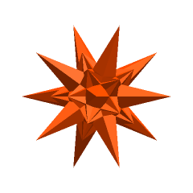
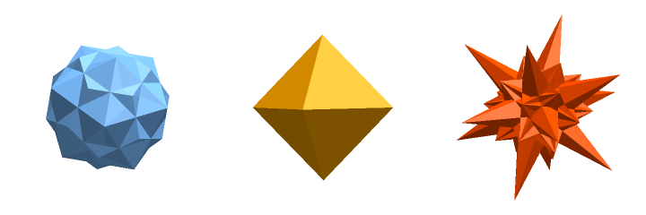
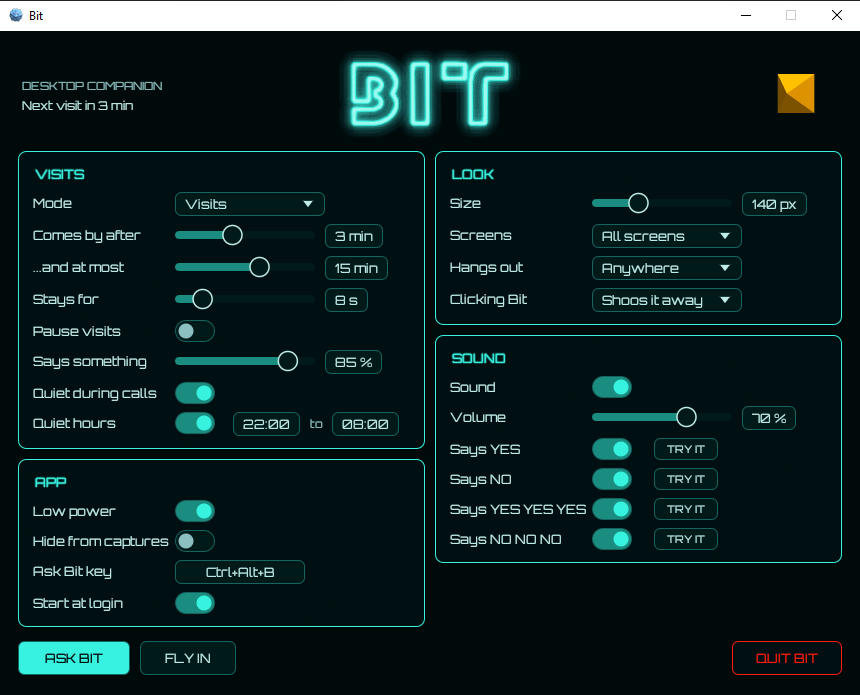

# Bit — desktop companion

Bit, the yes/no companion from *Tron* (1982), visits your desktop now and then: it darts in, hovers, sometimes says yes or no, and speeds off. Or it can stay with you, roaming a screen or hovering in one spot. It lives in the system tray.

<p align="center"></p>

<p align="center"></p>



On screen Bit has no window or background of its own: only Bit itself is drawn over your desktop.

- **Tray icon:** left-click for Settings; right-click for *Ask Bit*, *Show Bit now*, *Pause visits*, *Always on*, *Settings* and *Quit Bit*.
- **Ask Bit** (tray menu, the ASK BIT button, or Ctrl+Alt+B anywhere; change the key under *Ask Bit key*): think of a yes/no question; Bit flies in, thinks for a moment and answers. Each answer is one bit from the operating system's secure random generator, so yes and no are exactly even and unpredictable. Bit always says its answer out loud, even with Sound switched off in Settings (your settings aren't changed).
- **Click Bit** while it's on screen to shoo it away (or have it answer, see *Clicking Bit* below).
- **Drag Bit** (Windows) to move it: it follows the pointer and carries on from where you let go, and it won't go onto a screen it's kept off. Holding it pauses the visit.
- Starting Bit again while it's running just opens its settings.
- **Quiet during calls** (on by default, Windows): no visits while any app is using your microphone, and Ask Bit answers silently.
- **Quiet hours** (on by default, 22:00 to 08:00): no visits between two times of day (Fly in and Ask Bit still work).
- **Says something:** how often Bit says yes or no on a visit.
- **On a visit:** *One answer* (default): Bit says yes or no once. *Changes its mind*: on a longer visit it sometimes says one, goes back to neutral for a moment, then says the other.
- **Screens:** all screens, the main screen only, all but the main screen, or *Chosen screens*: click screens on a little map of your desktop to light the ones Bit may visit. Bit never shows on a screen it's kept off, even when flying in or out (when no flight path keeps clear, it comes from and goes into the distance). If your screens are rearranged so a chosen one is gone, Bit visits all of them until you choose again.
- **Mode: Always on.** Instead of visiting, Bit stays on one screen (*On screen*), roaming it like something trapped behind the glass: it ricochets off the edges, lunges at them, stalls and sets off again. *Restlessness* sets how often it lunges and how fast it goes. Clicking it answers a question (or startles it, with *Clicking Bit* set to shoo). Set *Movement* to *Hovers* and it stays in one spot instead, drifting gently where *Hangs out* says (*Center* is the middle of the screen); drag it and it hovers at the new spot until it next leaves. *Says something* sets how often it says yes or no by itself, from never to about every 15 seconds, as the sound settings allow. Double-click Bit, or untick *Always on* in the tray menu, to go back to visits. Quiet hours, calls, full screen and *Pause* send it away until they end. It always flies at the low-power frame rate.
- **Hangs out:** where on a screen Bit mostly hovers: anywhere, center, top, bottom, left, right or the corners.
- **Clicking Bit:** shoos it away (default), asks it (it stops and answers yes or no), or does nothing (clicks pass straight through, so it can't be dragged either).
- **Sound:** volume, and a switch and TRY IT button for each of *yes*, *no*, the long *yes, yes, yes* and the long *no, no, no*. Bit's voice comes from clips of the movie. They've been cleaned up as far as reasonably possible, but the quality still isn't great.
- **Ask Bit key** (Windows): click it, then hold the keys you want (it shows them as you go), with Ctrl or Alt, or a function key alone. Esc keeps the old key and Delete turns it off. It shows *In use* if another program already has that key.
- **Hide from captures** (Windows; shown greyed out elsewhere): Bit stays on your screen but is left out of screenshots, recordings and screen sharing. Bit then draws through DirectComposition, which uses a little more memory and CPU during visits.
- **Low power** (on by default): Bit flies at about 30 frames a second instead of your display's rate, using less CPU. Switch it off for the smoothest flight.
- **Start at login** (Windows, on from the first run).
- Bit stays away while a full-screen game or presentation is running (Windows).

## Install

Download the package for your system from the repository's **Releases** page:

- **Windows:** `tron-bit.exe`, with Bit's icon built in. It isn't signed, so Windows blocks files downloaded from the internet: right-click `tron-bit.exe`, choose **Properties**, tick **Unblock** and click **OK**. If SmartScreen still warns on first run, choose **More info → Run anyway**. A good home for it is `%LOCALAPPDATA%\Programs\Bit\` (no admin rights needed).
- **Check a download (optional):** each release has `SHA256SUMS.txt` with the SHA-256 of every download. On Windows, in PowerShell in the folder you downloaded to: `Get-FileHash .\tron-bit-*-windows.zip` and compare the hash with the one in `SHA256SUMS.txt` (on macOS/Linux: `sha256sum -c SHA256SUMS.txt --ignore-missing`).
- **macOS:** `Bit.app`, with Bit's icon. It runs in the menu bar with no Dock icon. It isn't signed, so open it the first time with right-click → **Open**.
- **Linux:** two downloads, `linux` for 64-bit PCs (x86-64) and `linux-arm64` for 64-bit ARM (Armbian, Raspberry Pi OS 64-bit, Pinebook and similar). Each is the program plus `install.sh`, which adds Bit to your app menu with its icon (no root needed). Steps below.

### Installing on Linux

Pick the download for your machine: `uname -m` prints `x86_64` for the `linux` download or `aarch64` for `linux-arm64`. In a terminal, from the folder you downloaded it to (version number and name as downloaded):

1. Unpack it:

   ```sh
   tar -xzf tron-bit-0.4.0-linux.tar.gz
   cd tron-bit-0.4.0-linux
   ```

2. Install it for your user (no `sudo` needed). This puts the program in `~/.local/bin`, its icon in your icon theme, and **Bit** in your app menu:

   ```sh
   ./install.sh
   ```

   Use `./install.sh --autostart` to also start Bit when you log in. On small ARM laptops and boards, or any machine where Bit's windows come up black, install with `--software` as well:

   ```sh
   ./install.sh --software --autostart
   ```

3. Start it from your app menu (search for "Bit"), or run `~/.local/bin/tron-bit`.

If it won't start, run `~/.local/bin/tron-bit` in a terminal to see the error. A message about a missing `.so` library means a runtime package is missing:

- Ubuntu, Debian, Mint: `sudo apt install libgtk-3-0 libayatana-appindicator3-1 libxdo3`
- Fedora: `sudo dnf install gtk3 libayatana-appindicator-gtk3 libxdo`

No tray icon on GNOME (Ubuntu's default desktop)? Install the *AppIndicator and KStatusNotifierItem Support* extension. KDE shows tray icons out of the box.

Settings window all black? That's an old or limited graphics chip (common on small ARM laptops and boards). Test it from a terminal:

```sh
LIBGL_ALWAYS_SOFTWARE=1 ~/.local/bin/tron-bit
```

If that fixes it, make it permanent: typed like that, the setting only lasts for that one run, so Bit goes black again from the menu or after a reboot. Quit Bit, then reinstall from the same folder with `--software`, adding `--autostart` if Bit starts at login (each reinstall replaces the last, so include every option you want):

```sh
./install.sh --software --autostart
```

Bit then always starts that way, from the menu and at login. It's slower to draw, but works.

Bit's icon missing from the menu right after installing? Log out and back in, or reboot: some menus only notice a new icon then.

Bit flying inside a black square instead of on its own? Check that your desktop's compositor is on (on XFCE: Settings → Window Manager Tweaks → Compositor → *Enable display compositing*). See-through windows need it.

If Bit's icon is missing from your app menu right after installing, log out and back in, or reboot.

To remove Bit, run `./install.sh --uninstall` from the same folder. Your settings stay in `~/.config/tron-bit`.

**Steam Deck (not tested yet):** SteamOS is 64-bit PC Linux, so the `linux` download should be the right one. Here's what should work, and we'd welcome a report either way:

1. Switch to Desktop Mode (Steam button → Power → Switch to Desktop) and open Konsole.
2. Download the `linux` package, then unpack and install it as above. `install.sh` needs no `sudo` and only writes to your home folder, so SteamOS updates should leave it alone:

   ```sh
   tar -xzf tron-bit-0.4.0-linux.tar.gz
   cd tron-bit-0.4.0-linux
   ./install.sh --autostart
   ```

3. Start **Bit** from the app menu. KDE shows the tray icon out of the box.

If it complains about a missing library (GTK or the tray libraries), that's the most likely problem: SteamOS's system is read-only and leaves many of them out, so Bit may need packaging differently there. If the settings window is black, reinstall with `--software`. Expect Bit in Desktop Mode only: Gaming Mode is a separate full-screen session, so Bit probably won't appear over games, even when added to Steam as a non-Steam game. Clicking, dragging and the Ask Bit key are Windows-only for now.

**ARM boards:** use the `linux-arm64` download on 64-bit ARM (`uname -m` shows `aarch64`). A 32-bit ARM system (`armv7l`) has no download; build Bit on it with the steps under *Build from source* (the first build takes a long time on a small board, often 30 minutes or more), then install it from the source folder with the same script:

```sh
packaging/linux/install.sh            # or add --software and/or --autostart
```

Older ARM laptops and boards may need `--software` (see the black settings window note above). Bit draws itself on the CPU, so visits cost more on a small board than on a PC (turn on **Low power**).

## How it works

| Part | File |
|---|---|
| Bit's shapes and a small software renderer | `src/bit.rs` |
| Flight paths and moods | `src/flight.rs` |
| Bit's thread: one clock drives motion, drawing and voice | `src/visits.rs` |
| Voice: the WAV clips, levelled and resampled to the device | `src/audio.rs` |
| See-through window (Windows layered window, or DirectComposition when hiding from captures; paced by `DwmFlush`) | `src/overlay.rs` |
| Settings window (egui; on Windows a short-lived process of its own) | `src/ui.rs`, `src/window.rs` |
| Tray, single instance, start/quit | `src/main.rs` |

Between visits Bit uses no CPU and holds no window, audio stream or GPU context. The settings window exists only while it's open; on Windows it runs as a separate process (`tron-bit.exe --settings`, started by Bit), so closing it hands back all of its memory, graphics driver included. Quitting stops Bit's thread, fades out any sound, saves settings and removes the tray icon before the program exits.

Assets in `assets/`: `bit.bin` (Bit's model: [BIT](https://www.thingiverse.com/thing:2748353) by Ferjerez, licensed under [CC BY 4.0](https://creativecommons.org/licenses/by/4.0/), converted from its STL files to Bit's own format), the four voice WAVs, the Orbitron font (SIL Open Font License, see `assets/licenses`), and `grid_outline.ttf` for the BIT title ("Grid Outline", traced from the preview of the TR2N font v2.0 on DeviantArt; letter designs by its author).

## Memory and CPU

Measured on Windows 10 with Bit at its usual size, the settings window closed (private memory, CPU as a share of one core):

| | Memory | CPU (normal / low power) |
|---|---|---|
| Between visits | about 3 MB | none |
| During a visit | about 23 MB at most | about 8% / 4% |
| During a visit with **Hide from captures** on | about 37 MB at most | about 14% / 7% |
| Always on, roaming or hovering (always low power) | about 7 MB | about 5% |
| Right after a visit | about 4 MB (about 15 MB if Hide from captures is on) | none |
| Settings window open | about 110 MB, in its own process that ends when the window closes | a few percent |

Hide from captures costs more because Windows only keeps a window out of screenshots if it's drawn through DirectComposition and Direct3D, which bring their own driver memory. With it off, Bit uses a plain layered window, the leanest way to draw a see-through shape. The settings window's memory is mostly OpenGL and its driver. Windows never unloads a graphics driver from a process once it's loaded, so the window runs as a process of its own: when it closes, that process ends and all of it is handed back, and Bit itself stays at about 3 MB.

## Build from source

Bit is written in Rust. On every platform the steps are: install the system build tools, install Rust, get the code, and run `cargo build --release`. The first build downloads its libraries and takes a few minutes; later builds are quick.

The result is a single self-contained program (Bit's model, sounds and font are built in) that can be copied anywhere and run from there:

| Platform | Program |
|---|---|
| Windows | `target\release\tron-bit.exe` |
| macOS, Linux | `target/release/tron-bit` |

### 1. System build tools

**Windows 10/11.** Rust needs Microsoft's C++ linker and the Windows SDK. Install *Build Tools for Visual Studio* and tick **Desktop development with C++**:

```powershell
winget install Microsoft.VisualStudio.2022.BuildTools
```

(Or download it from visualstudio.microsoft.com/downloads, under *Tools for Visual Studio*. A full Visual Studio with the same workload also works.)

**macOS 11 or later.** Install Apple's command-line developer tools:

```sh
xcode-select --install
```

**Linux.** Install a C compiler, `pkg-config`, and the development packages for GTK 3 and the tray (tray icon and menu), ALSA (sound), and X11/Wayland keyboard handling (settings window):

```sh
# Debian, Ubuntu, Mint, Pop!_OS
sudo apt install build-essential pkg-config libgtk-3-dev libxdo-dev \
    libayatana-appindicator3-dev libasound2-dev libxkbcommon-dev

# Fedora
sudo dnf install gcc pkgconf-pkg-config gtk3-devel libxdo-devel \
    libayatana-appindicator-gtk3-devel alsa-lib-devel libxkbcommon-devel

# Arch, Manjaro
sudo pacman -S --needed base-devel pkgconf gtk3 xdotool \
    libayatana-appindicator alsa-lib libxkbcommon
```

### 2. Rust

Install Rust with rustup, accepting the defaults, then open a new terminal so `cargo` is on the path.

```powershell
# Windows
winget install Rustlang.Rustup
```

```sh
# macOS and Linux
curl --proto '=https' --tlsv1.2 -sSf https://sh.rustup.rs | sh
```

(rustup.rs has the same installers.) Bit needs Rust 1.89 or newer; `rustup update` brings an older install up to date.

### 3. Get the code

```sh
git clone https://github.com/Space-Paranoids/tron-bit-desktop
cd tron-bit-desktop
```

### 4. Build and run

```sh
cargo build --release
```

Then run the program from the table above. Bit appears in the system tray; its first visit comes after the interval in Settings (left-click the tray icon, or use **FLY IN** / **ASK BIT** to see it straight away).

`cargo test --release` runs the tests.

## Settings

Settings save automatically to `settings.toml` in:

- Windows: `%APPDATA%\tron-bit\`
- macOS: `~/Library/Application Support/tron-bit/`
- Linux: `$XDG_CONFIG_HOME/tron-bit/` or `~/.config/tron-bit/`

## Platform notes

Windows is the main tested platform, and the Linux ARM build has been run on a Pinebook. macOS and Linux builds use the same Bit thread, renderer and audio, but show Bit through a transparent egui window that clicks pass through (so no clicking or dragging Bit, and no Ask Bit key) and keep the settings window alive (closing it minimizes it). macOS is untested. On Linux the tray needs an AppIndicator/StatusNotifier host (built into KDE; on GNOME, the *AppIndicator and KStatusNotifierItem Support* extension). On Wayland, desktops may not let a window place itself, so Bit's flight paths work best under X11. On Windows, `tron-bit.exe` has to be unblocked first (right-click → **Properties** → tick **Unblock**), and on macOS the first launch needs right-click → **Open**, since the program isn't signed on either.

## Code signing policy

Windows releases are built and released only by this repository's GitHub Actions workflow (`.github/workflows/build.yml`), from a version tag, and are code signed through [SignPath.io](https://about.signpath.io/) once the project's free open-source signing is approved (free code signing provided by SignPath.io, certificate by the SignPath Foundation). Until then they are unsigned. Every release lists the SHA-256 of each download in `SHA256SUMS.txt`.

- Committers, reviewers and approvers: [Space-Paranoids](https://github.com/Space-Paranoids) (the owner). Every signing request is approved by hand.
- Privacy: this program will not transfer any information to other networked systems unless specifically requested by the user or the person installing or operating it. (Bit makes no network connections at all.)

## License

Bit's own code is under the [MIT License](LICENSE). The model, fonts and voice clips in `assets/` keep their own terms (see the assets notes above).

## Disclaimer

Bit is a personal, non-commercial fan project. It is provided "as is", without warranty of any kind, express or implied, including fitness for a particular purpose. It is not supported: there is no promise of fixes, updates or help.

You use it entirely at your own risk. The author is not responsible or liable for any damage, data loss, interruption or other problem arising from downloading, building or using it.

This project is not affiliated with, endorsed by or connected to The Walt Disney Company. TRON, Bit and related names and characters are trademarks or copyrights of their respective owners and are used here only for non-commercial fan purposes. Bit's 3D model is the work of Ferjerez (CC BY 4.0, see the assets notes above), and the fonts belong to their respective authors (see the assets notes above).
